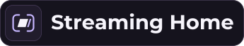
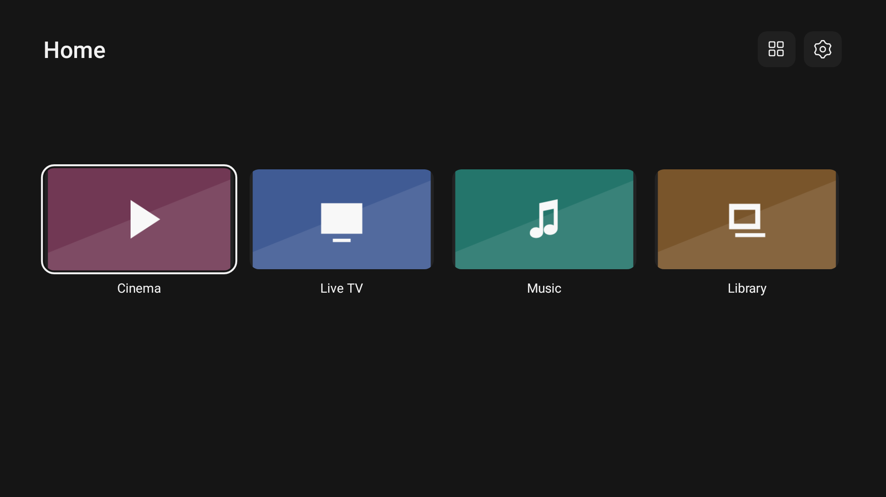
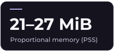
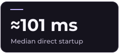

<h1 align="center">
  
</h1>

<strong>Your TV. Your apps. Nothing else.</strong>

A lightweight, ad-free launcher for Fire TV. Pin the apps you use and open them with your remote.

  <a href="https://github.com/ibraking09/streaming-home/releases/latest"><strong>Download APK</strong></a>
  · <a href="#quick-start">Install</a>
  · <a href="#compatibility">Compatibility</a>

  
  

*Home on Fire TV, shown with four demo apps.*

## Performance

  
  
  

The memory and startup figures are historical development measurements on a Fire TV Stick 4K Plus. PSS is the launcher's share of memory, including a proportion of shared pages. **Optional Home-button redirection took 1.77–2.59 seconds** and follows a separate path through Fire OS. [Measurement context and limitations](docs/PERFORMANCE.md)

## Make it yours

- **Keep favorites within reach.** Pin and reorder apps with the remote. Hold Select and release for an app menu, or use **Launcher settings → Edit Home**.
- **Find your installed apps.** All Apps automatically discovers launchable apps and sorts them alphabetically, with their installed TV banners and icons where available.
- **Set up your screen.** Adjust the background, tile size, labels, and focus animations. Favorites and appearance preferences stay on the device.
- **Use stock Fire OS.** The native Android launcher runs without root or mandatory debloating. It has no accounts, subscriptions, analytics, or network permission.

*Launcher settings. Edit favorites, change the look, or open Fire OS Settings and Amazon Home.*

## Quick start

1. Check [compatibility](#compatibility). Open **Assets** on [the latest release](https://github.com/ibraking09/streaming-home/releases/latest) and download the signed APK and `SHA256SUMS`.
2. Verify the download and choose an installation method. For ADB, use a computer and enable ADB debugging on the Fire TV.
3. Open **Streaming Home** from Amazon’s Apps library. You can use it standalone or [opt in to Home-button redirection](docs/INSTALL.md#optional-home-redirection).

[Linux/macOS](docs/INSTALL.md#linux-and-macos) · [Windows PowerShell](docs/INSTALL.md#windows-powershell) · [Manual ADB](docs/INSTALL.md#c-manual-adb) · [Full installation guide](docs/INSTALL.md)

## Compatibility

**Verified on Fire TV Stick 4K Plus** (`AFTMA08C15`), Fire OS 8.1.8.5 (`RS8185/3898`), Android 11 (API 30). The APK requires API 30 or newer. Other devices and firmware are untested. Vega OS is incompatible with the Android APK.

With redirection enabled, Amazon Home may appear briefly when you press Home. An Appstore session opened from Streaming Home temporarily suspends redirection. Reopen Streaming Home from Amazon’s Apps library to resume it.

[Compatibility and known limitations](docs/COMPATIBILITY.md) · [Report a device result](https://github.com/ibraking09/streaming-home/issues/new?template=device_compatibility.yml)

## Project

[Documentation](docs/README.md) · [Roadmap](docs/ROADMAP.md) · [Contributing](CONTRIBUTING.md) · [Changelog](CHANGELOG.md) · [Security](SECURITY.md)

Streaming Home is an independent open-source project, unaffiliated with Amazon. [MIT license](LICENSE) · [Third-party notices](THIRD_PARTY_NOTICES.md)
