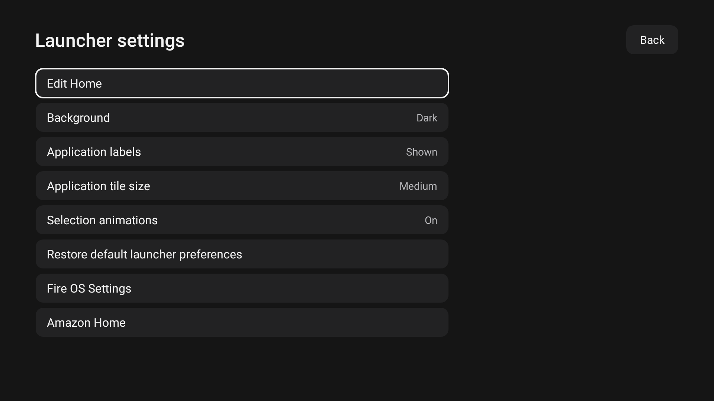

# Streaming Home

A lightweight, customizable, ad-free native launcher for Amazon Fire TV devices. No root required.

Streaming Home is an independent community project and is not affiliated with Amazon.

[Download v0.1.0](https://github.com/ibraking09/streaming-home/releases/tag/v0.1.0) · [Installation](docs/INSTALL.md) · [Compatibility](docs/COMPATIBILITY.md) · [Build from source](docs/BUILD.md)

The screenshot shows the launcher running with four installed demo apps.

- Pin or reorder apps from the remote and tune the background, tile size, labels, and selection animations.
- Browse installed apps in an alphabetical All Apps grid with their installed banners and icons.
- Open Fire OS Settings and Amazon Home from launcher settings.
- Choose optional Home redirection on the verified firmware.

## Quick start

You can install Streaming Home on stock Fire OS. Download the signed APK and checksum from the release page. Follow the standalone, guided, or manual ADB method in the [installation guide](docs/INSTALL.md). Open **Streaming Home** from Amazon’s Apps library. Hold Select and release to open an app menu, or choose **Settings → Edit Home** to manage favorites using short presses.

## Compatibility

| Device | Model | Firmware | Android |
|---|---|---|---|
| Verified Fire TV Stick 4K Plus | AFTMA08C15 | Fire OS 8.1.8.5 (RS8185/3898) | Android 11, API 30 |

Standalone installation requires Android API 30 or later. Other firmware and devices are untested. Vega OS cannot install this Android APK. [Compatibility and known limitations](docs/COMPATIBILITY.md)

## Home redirection and privacy

The optional accessibility service reacts to window-state metadata from Amazon’s launcher. It cannot retrieve window content or intercept keys. Fire OS can briefly show Amazon Home before the redirect. Reopen Streaming Home from Amazon's Apps library after an intentional Appstore or Amazon Home session.

The app has no network permission, ads, accounts, subscriptions, or analytics. Favorites and appearance preferences are stored on the device. Guided installers use the network to fetch the release and connect to your device over ADB.

## Project maintenance

[Update, uninstall, and recover](docs/INSTALL.md#update-uninstall-and-recovery) · [Contributing](CONTRIBUTING.md) · [Security](SECURITY.md) · [Changelog](CHANGELOG.md)

Streaming Home is available under the [MIT license](LICENSE). [Third-party notices and research acknowledgments](THIRD_PARTY_NOTICES.md)
